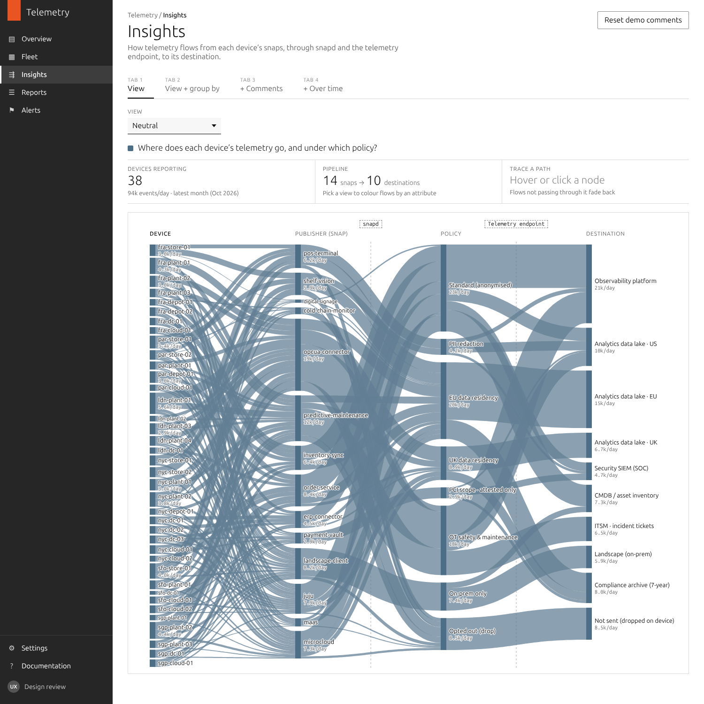
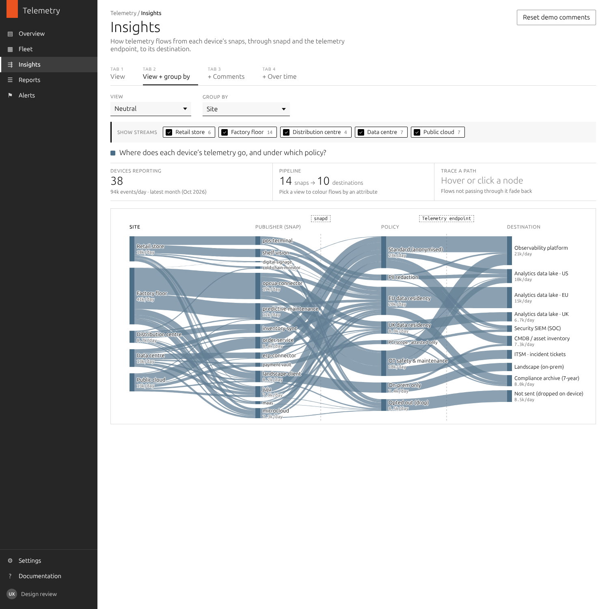
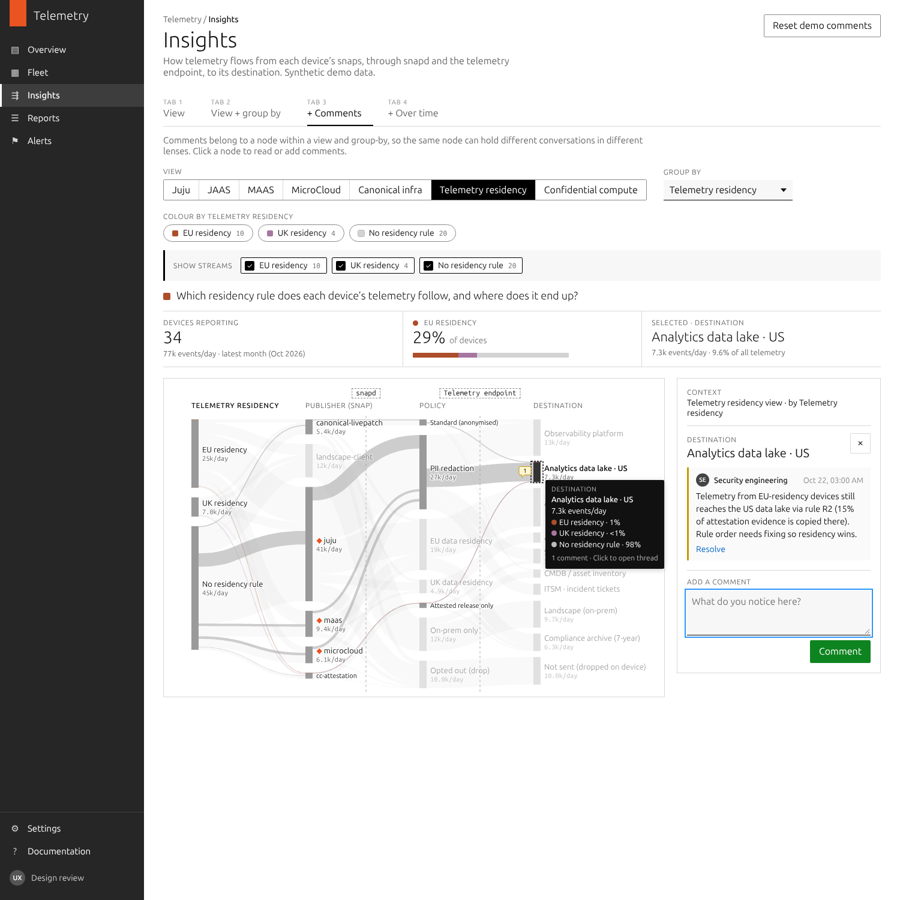
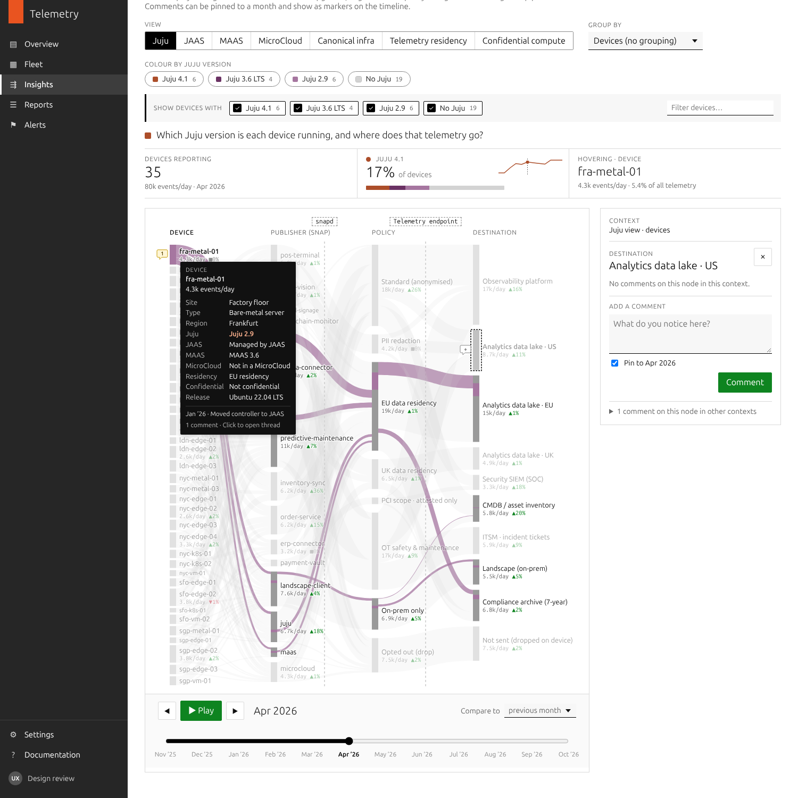

# Telemetry · Insights (Sankey prototype)

A dependency-free prototype of the **Insights** page for Ubuntu telemetry. It shows how telemetry flows through the pipeline:

```
[ column 1 ]  →  Publisher (snap)  →  Policy  →  Destination
                                 ┆ snapd      ┆ telemetry endpoint
```

**Architecture:**
1. Every snap on a device hands its telemetry to **snapd**.
2. snapd enforces naming and on-device rules, then merges all snaps into **one stream** to the **telemetry endpoint**.
3. The endpoint splits the stream back out by snap, applies routing policy and forwards each flow to its destination.

snapd and the endpoint are drawn as dashed markers between the columns. Every flow passes through them, so neither needs a column of its own. Each policy rule records where it's applied: `at: 'snapd'` (on the device) or `at: 'endpoint'`.

**Only column 1 changes.**
- With **no group-by**, column 1 has one node per **device**.
- With a **group-by** (e.g. Juju version), the devices collapse into streams per value (4.1 / 3.6 / 2.9 / none). Publisher, policy and destination stay the same.

A **view** colours every device by one attribute and carries that colour through its flows to the destination. For example, the Juju view colours each device by its Juju version. Views never change the columns.

Open `index.html` directly in a browser; there's no build step. All data is **synthetic** and seeded.

| Tab | Capabilities |
|---|---|
| 1 · View | Devices coloured by the view attribute. Click a colour to isolate it. Hover or click a node to trace its full path |
| 2 · View + group by | Column 1 collapses to group-by values. Chips filter streams; Alt-click shows only one. With devices, the chips filter by view value and a search box filters by name |
| 3 · + Comments | Comments on any node, scoped to view and group-by. Comments on the same node in other contexts are linked |
| 4 · + Over time | 12-month scrubber with play, deltas against a baseline, comments pinned to a month, and timeline markers |

## Devices

Device names say where the device is: `<region>-<site>-<nn>`, e.g. `fra-plant-01`, `nyc-store-02`, `sgp-cloud-01`. Site codes are `store` (retail store), `plant` (factory floor), `depot` (distribution centre), `dc` (data centre) and `cloud` (public cloud). In column 1, devices are sorted by region, then site.

## Publishers (snaps)

The fleet is modelled on a large retailer or manufacturer, spread across retail stores, factory floors, distribution centres, data centres and public cloud. Most publishers are the customer's own or partner applications; Canonical infrastructure snaps are a minority.

| Site | Typical snaps |
|---|---|
| Retail store | `pos-terminal`, `shelf-vision`, `digital-signage`, `cold-chain-monitor` |
| Factory floor | `opcua-connector`, `predictive-maintenance`, `digital-signage` |
| Distribution centre | `inventory-sync`, `cold-chain-monitor`, `predictive-maintenance` |
| Data centre | `erp-connector`, `inventory-sync`, `order-service` |
| Public cloud | `order-service`, `erp-connector`, `predictive-maintenance` |
| Any site | `landscape-client`, plus `juju`, `maas`, `microcloud` where used. `payment-vault` runs on confidential VMs |

Policy rules route these by sensitivity:
- camera and till data get PII redaction in snapd (R6),
- factory and sensor data follow the OT policy to observability and ITSM (R7),
- payment data is PCI scope, attested only (R2).

## Health

Health is a composite score from 0 to 100 per device per month, made of weighted components (`HEALTH_COMPONENTS` in `js/data.js`):

| Component | Weight |
|---|---|
| Security patch currency | 25% |
| Snap refresh currency | 20% |
| Release support (26.04 = 100 … 20.04 ESM = 15) | 15% |
| Reporting regularity | 15% |
| Policy compliance | 15% |
| Stability (crash rate) | 10% |

The score is shown in ten bands: 0–10, 11–20 … 91–100.

**Colours.** The bands use a diverging gradient built from the design palette:
- **Worst bands:** the palette's rusts (`#79331A`, `#AC4E2A`, `#BC6D4C`).
- **Middle bands:** a neutral taupe and olive.
- **Best bands:** the palette teal (`#63998C`), darkening to deep teal.

The intermediate steps were interpolated in OKLCH. Lightness mirrors either side of the middle, and adjacent bands are roughly equal visual steps apart.

**In the interface:**
- The KPI shows the fleet's average score, with its monthly trend on the Over time tab.
- In the Health view, each device's tooltip breaks the score down by component.

### Health incident (Jun–Sep 2026)

The data includes a fleet incident to show change over time. All of it is defined in `INCIDENT` in `js/data.js`.

| Month | What happens | Fleet avg | Factories |
|---|---|---|---|
| Jun | `opcua-connector` r214 crash-loops on factory devices; their telemetry drops by more than half | 69 | 56 |
| Jul | A fleet-wide snap refresh hold contains it, but snap and patch currency slide everywhere | **56** | **39** |
| Aug | Factories are rolled back to r212; the hold is lifted for everything else | 67 | 58 |
| Sep | Fixed r216 ships after a canary soak; health is back to pre-incident levels | 73 | 69 |

Before the incident, the fleet average was 73 and factories averaged 69.

Two SREs discuss and resolve the incident in a comment thread. To find it, choose **Device health** and group by **Site**, then open **Factory floor**. On the Over time tab, the thread's comments show as markers from June to September.

## Views

The view selector is a dropdown. It starts on **Neutral**, where every flow is one colour (palette slate) with no breakdown.

| View | Colours devices by | Values |
|---|---|---|
| Neutral | Nothing (one colour) | All telemetry |
| Device health | Health band | 0–10 … 91–100 |
| Telemetry residency | Residency rule the device's telemetry follows | EU · UK · none |
| Confidential compute | Confidential-computing hardware | Intel TDX · AMD SEV-SNP · none |
| *Canonical infrastructure:* Full / partial stack | Derived stack | full (Juju + MAAS/MicroCloud) · partial · none |
| *Canonical infrastructure:* Juju | Juju version | 4.1 · 3.6 LTS · 2.9 · none |
| *Canonical infrastructure:* JAAS | Juju controller | JAAS · self-hosted · none |
| *Canonical infrastructure:* MAAS | MAAS version | 3.6 · 3.5 · none |
| *Canonical infrastructure:* MicroCloud | MicroCloud membership | member · none |

Group-by can use any of these attributes, plus site, device type, region and Ubuntu release.

## Data structure (`js/data.js`)

```
ATTRIBUTES    { attr → { label, values: [{ id, label, color? }] } }   // device vocabulary; no colour = neutral
PUBLISHERS / POLICIES / DESTINATIONS                                 // publishers are snaps (snap names)
WAYPOINTS     [{ after: 'publisher'|'policy', label }]                // snapd, telemetry endpoint
ROUTING       [{ id, at: 'snapd'|'endpoint', when: {attr|publisher: value|[values]}, policy, to: [[destination, share]] }]
              // ordered, first match wins — auditable and easy to change
DEVICES       [{ id, attrs, extras, onboarded, scale, growth,
                 changes: [{ month, attrs, note }] }]                 // upgrades, migrations, policy moves
VIEWS         [{ id, attr, label, question }]
GROUP_BYS     ['device', …attributes]
```

- `snapshot(month)` expands devices × publishers × routing into flow facts: `{ device, …attrs, publisher, policy, destination, rule, count }`.
- `sankey.aggregate(facts, [col1, 'publisher', 'policy', 'destination'], { segAttr: view.attr, filter, focus })` gives every node and link a `seg` breakdown by view value. That breakdown is what colours flows end to end.
- Node ids are `"<dimension>:<value>"` (e.g. `juju:3.6`, `device:fra-plant-01`, `policy:eu-res`). They stay the same across time, views and group-bys.
- Columns are top-aligned, so the top stream runs horizontally and lower streams rise into it. Node order is fixed, so playback doesn't reshuffle.

The routing rules deliberately contain a realistic flaw. Rule R2 (payment-vault telemetry, applied at the endpoint) comes before R4 (EU residency), so a little payment telemetry from EU-residency devices is copied to the US data lake. The Telemetry residency view makes this visible, and a seeded comment flags it.

## Comments (`js/comments.js`)

```
{ id, anchor: { view, groupBy, node, period|null }, author, body, createdAt, resolved }
```

Comments are stored in `localStorage`. **Reset demo comments** restores the seed set.

## Files

```
index.html        layout: left nav (Insights active), header, tabs
css/app.css       Canonical/Vanilla-style app styling
js/data.js        attributes, pipeline, routing rules, devices, views
js/sankey.js      aggregate · interpolate · layout · SVG render
js/comments.js    comment store
js/app.js         page controller and tab capability flags
docs/             screenshots
```

## Screenshots

| | |
|---|---|
|  |  |
|  |  |
