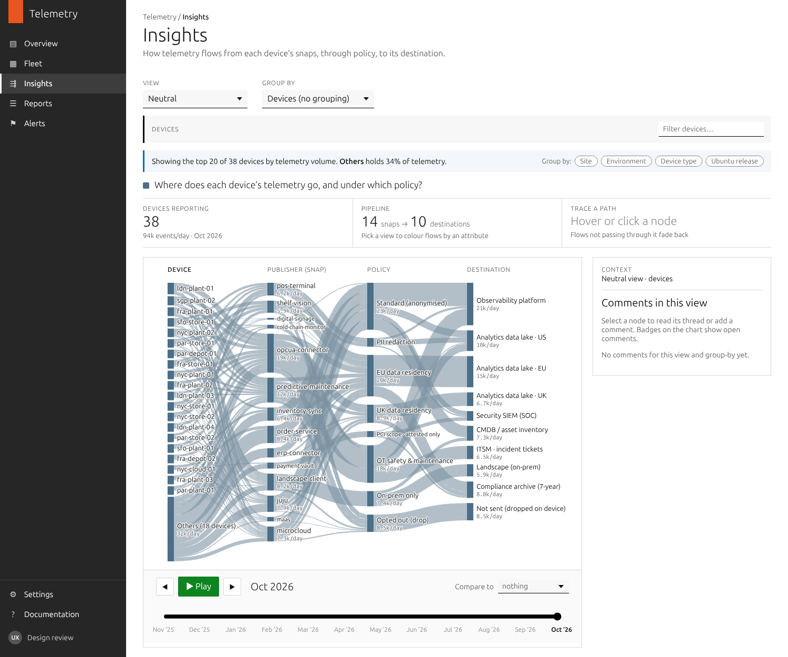
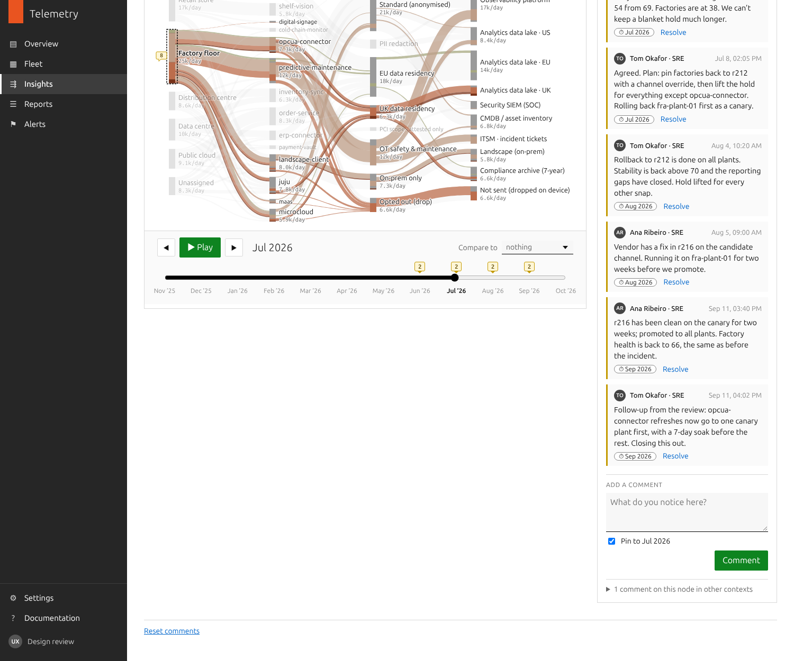

# Telemetry · Insights (Sankey prototype)

A dependency-free prototype of the **Insights** page for Ubuntu telemetry. It shows how telemetry flows through the pipeline:

```
[ column 1 ]  →  Publisher (snap)  →  Policy  →  Destination
                                 ┆ snapd      ┆ telemetry endpoint
```

**Architecture:**
1. Every snap on a device hands its telemetry to **snapd**.
2. snapd enforces naming and on-device rules, then merges all snaps into **one stream** to the **telemetry endpoint**.
3. The endpoint splits the stream back out by snap, applies routing policy and forwards each flow to its destination.

snapd and the endpoint aren't drawn in the chart. Every flow passes through them, so they'd add no information. Each policy rule records where it's applied: `at: 'snapd'` (on the device) or `at: 'endpoint'`.

**Only column 1 changes.**
- With **no group-by**, column 1 has one node per **device**.
- With a **group-by** (e.g. Juju version), the devices collapse into streams per value (4.1 / 3.6 / 2.9 / none). Publisher, policy and destination stay the same.

A **view** colours every device by one attribute and carries that colour through its flows to the destination. For example, the Juju view colours each device by its Juju version. Views never change the columns.

Open `index.html` directly in a browser; there's no build step. All data is **synthetic** and seeded.

It's a single page with every capability switched on:

- **View:** a dropdown that starts on Neutral. Other views colour devices and their flows by an attribute; click a colour to isolate it.
- **Group by:** column 1 collapses to the group-by values. Chips filter the streams, and Alt-click shows only one. When showing devices, a search box filters them by name.
- **Path tracing:** hover or click any node to trace its full path.
- **Comments:** attach to any node, scoped to the current view and group-by. Comments on the same node in other contexts are linked.
- **Timeline:** a 12-month scrubber with play. Comments can be pinned to a month and show as timeline markers. Change percentages appear only when "Compare to" is set.

**Reset comments** at the bottom of the page restores the seeded comments.

## Fleet size and the ladder

The page adapts to fleet size. For demos, the fleet is chosen with an invisible URL parameter:

| URL | Fleet | What the page does |
|---|---|---|
| `?fleet=hobby` | 6 home-lab devices with home snaps (`home-automation`, `media-server`, `file-sync`, `dns-filter`) | Shows every device, with no prompts |
| none, or `?fleet=mid` | The 38 devices described below | Shows the top 20 devices plus **Others**, with a note explaining what Others holds and offering quick group-bys |
| `?fleet=enterprise` | 5,000 devices: the same 38, plus generated ones | Opens grouped by Site. Select a group, then **Show devices in this group**, to drill into its top 20 plus Others |

**The ladder** (`LADDER` in `js/app.js`):

| Devices | Default view | Note shown |
|---|---|---|
| Up to 15 | Every device | None |
| 16–30 | Every device | A nudge to group |
| 31+ | Top 20 plus Others | What Others hides |
| 100+ | Grouped by Site | How to drill into a group |

**How the top 20 is chosen:**
- **Ranking follows the view.** Neutral ranks by telemetry volume, Device health by lowest health, Lifecycle by risk, and Energy puts idle devices first, then the biggest energy users.
- **The column is listed in rank order,** most notable at the top, with Others last.
- **Membership is frozen to the latest month,** so the list doesn't reshuffle while scrubbing.
- **Some devices are always shown:** devices with comments in the current view, the selected device, and the device whose tooltip is open.
- **Minimum height:** in column 1, each named device gets a minimum bar height so its name stays readable. Its flows stay proportional to its real volume.

**What the Others note says:** how much telemetry Others holds and, for Health, Lifecycle and Energy, how many devices needing attention it hides. For example: "Others holds 98% of telemetry and 226 of the 246 unhealthy devices".

**Mid fleet unchanged:** the enterprise fleet generates its extra devices after the original 38, so those 38 keep identical data in both fleets.

## Devices

Device names say where the device is: `<region>-<site>-<nn>`, e.g. `fra-plant-01`, `nyc-store-02`, `sgp-cloud-01`. Site codes are `store` (retail store), `plant` (factory floor), `depot` (distribution centre), `dc` (data centre) and `cloud` (public cloud). In column 1, devices are sorted by region, then site.

## Assigning manual keys

Site and Environment are **manual** keys: labels people assign, such as Landscape tags. Some devices start without one, and grouping by that key shows them as an **Unassigned** stream.

- **Assigning:** an unassigned key shows a blue **Assign** link in the device tooltip. Click (or tap) the device once to open the tooltip, then click Assign. On touch screens there's no hover preview, so the first tap opens the tooltip straight away.
- **The modal:** it has a text field that autocompletes to the key's existing values, including near matches (typing `factory2` also shows Factory floor), so people reuse values where they can.
  - If the text isn't an existing value, the list offers **+ Create "factory2" as a new site**, and the button changes to **Create and assign**.
  - An exact match, ignoring case, reuses the existing value instead of creating a duplicate.
  - New values become real values for that key: they get their own stream, filter chip and autocomplete entry.
  - For Site, the modal also suggests a value inferred from the hostname, e.g. `nyc-dc-01` → Data centre.
- **Effect:** the chart, groups and filter chips update immediately. The assignment is described as being shared with Landscape as a tag. In the prototype, assignments and new values are saved in the browser, and **Reset assignments** in the footer clears both.
- **Model:** each device keeps its true site, so its snaps, health and the incident data don't change while the label is missing.

## Device tooltip

**Hover** shows a quick preview. **Click (or tap) a device** to open its tooltip.

**Stays open while you:**
- expand Sustainability or use an Assign link (the assign dialog doesn't close it);
- scrub the timeline, which updates its contents to the selected month;
- scroll the page, since it's anchored to its device.

**Closes on:**
- a click outside the chart;
- a click on another device, which opens that device's tooltip instead;
- a click on a non-device node;
- a filter change: view, group by, colour chips, filter chips or device search;
- Escape, for keyboard users.

## Publishers (snaps)

The fleet is modelled on a large retailer or manufacturer, spread across retail stores, factory floors, distribution centres, data centres and public cloud. Most publishers are the customer's own or partner applications; Canonical infrastructure snaps are a minority.

| Site | Typical snaps |
|---|---|
| Retail store | `pos-terminal`, `shelf-vision`, `digital-signage`, `cold-chain-monitor` |
| Factory floor | `opcua-connector`, `predictive-maintenance`, `digital-signage` |
| Distribution centre | `inventory-sync`, `cold-chain-monitor`, `predictive-maintenance` |
| Data centre | `erp-connector`, `inventory-sync`, `order-service` |
| Public cloud | `order-service`, `erp-connector`, `predictive-maintenance` |
| Any site | `landscape-client`, plus `juju`, `maas`, `microcloud` where used. `payment-vault` runs on confidential VMs |

Policy rules route these by sensitivity:
- camera and till data get PII redaction in snapd (R6),
- factory and sensor data follow the OT policy to observability and ITSM (R7),
- payment data is PCI scope, attested only (R2).

## Health

Health is a composite score from 0 to 100 per device per month, made of weighted components (`HEALTH_COMPONENTS` in `js/data.js`):

| Component | Weight |
|---|---|
| Security patch currency | 25% |
| Snap refresh currency | 20% |
| Release support (26.04 = 100 … 20.04 ESM = 15) | 15% |
| Reporting regularity | 15% |
| Policy compliance | 15% |
| Stability (crash rate) | 10% |

The score is shown in ten bands: 0–10, 11–20 … 91–100.

**Colours.** The bands use a diverging gradient built from the design palette:
- **Worst bands:** the palette's rusts (`#79331A`, `#AC4E2A`, `#BC6D4C`).
- **Middle bands:** a neutral taupe and olive.
- **Best bands:** the palette teal (`#63998C`), darkening to deep teal.

The intermediate steps were interpolated in OKLCH. Lightness mirrors either side of the middle, and adjacent bands are roughly equal visual steps apart.

**In the interface:**
- The KPI shows the fleet's average score, with its monthly trend shown next to it.
- In the Health view, each device's tooltip breaks the score down by component.

Devices on **Juju 2.9** (out of support) score lower on patching, snap refreshes, stability and reporting. They average about 50, against the high 70s for Juju 4.1. Their scores recover once upgraded; for example, `nyc-cloud-01` goes from 68 to 93 when it moves to 3.6 in June.

### Health incident (Jun–Sep 2026)

The data includes a fleet incident to show change over time. All of it is defined in `INCIDENT` in `js/data.js`.

| Month | What happens | Fleet avg | Factories |
|---|---|---|---|
| Jun | `opcua-connector` r214 crash-loops on factory devices; their telemetry drops by more than half | 66 | 53 |
| Jul | A fleet-wide snap refresh hold contains it, but snap and patch currency slide everywhere | **54** | **38** |
| Aug | Factories are rolled back to r212; the hold is lifted for everything else | 64 | 56 |
| Sep | Fixed r216 ships after a canary soak; health is back to pre-incident levels | 71 | 66 |

Before the incident, the fleet average was about 69 and factories averaged about 65.

Two SREs discuss and resolve the incident in a comment thread. To find it, choose **Device health** and group by **Site**, then open **Factory floor**. The thread's comments show as timeline markers from June to September.

## Sustainability (views and device tooltip)

Sustainability signals are **device attributes**, joined in the control plane from what the fleet already reports, not extra payload. They're kept separate from health and shown in each device's tooltip (`sustainAt` in `js/data.js`).

**1. Lifecycle.** For edge and store hardware, most of the carbon is embodied in manufacture, so keeping devices in service longer matters most. The tooltip shows:
- hardware age;
- the date the OS is supported until (standard support, or ESM with Ubuntu Pro), using published Ubuntu lifecycle dates;
- a lifecycle status, which flags devices that would be replaced for **software reasons alone**.

For example, `ldn-plant-04` is on 20.04 without Pro. Its hardware is 6 years old and fine, and Ubuntu Pro would keep it in service until April 2030.

**2. Energy.** The tooltip shows the monthly energy (kWh) and band per physical device, its utilisation, and an "idle but powered on" flag. It also shows how the figure was measured:
- **Bare-metal servers:** Redfish (BMC platform power).
- **Edge devices:** CPU power counters (RAPL) read by `landscape-client`, the approach used by the open-source tool Kepler.
- **Edge devices without `landscape-client`:** shown as not measured.
- **Virtual machines:** shown as not attributed.

**Tooltip.** Sustainability is an accordion in the device tooltip. On hover it's collapsed to a one-line summary (lifecycle status · kWh/month). Clicking or tapping a device opens its tooltip, where the accordion can be expanded and Assign links used (see **Device tooltip** below). The section starts open in the Lifecycle and Energy views and collapsed elsewhere, and once someone opens or closes it, that choice is remembered.

**Views.** Both layers are also views (and group-by options) under **Sustainability** in the view dropdown:
- **Lifecycle** colours devices by status: can stay in service, standard support ending, software-only replacement risk, hardware due for refresh, or virtual. The KPI counts devices at software-only risk plus those whose support is ending; it rises from April 2026, a year before 22.04 standard support ends, then falls as devices upgrade to 26.04.
- **Energy** colours devices by monthly kWh band, on a sequential pale-taupe-to-rust ramp. Unmeasured and virtual devices are grey. The KPI shows total measured energy and how many idle devices are still powered on.

## Views

The view selector is a dropdown. It starts on **Neutral**, where every flow is one colour (palette slate) with no breakdown.

| View | Colours devices by | Values |
|---|---|---|
| Neutral | Nothing (one colour) | All telemetry |
| Device health | Health band | 0–10 … 91–100 |
| Telemetry residency | Residency rule the device's telemetry follows | EU · UK · none |
| Confidential compute | Confidential-computing hardware | Intel TDX · AMD SEV-SNP · none |
| *Canonical infrastructure:* Full / partial stack | Derived stack | full (Juju + MAAS/MicroCloud) · partial · none |
| *Canonical infrastructure:* Juju | Juju version | 4.1 · 3.6 LTS · 2.9 · none |
| *Canonical infrastructure:* JAAS | Juju controller | JAAS · self-hosted · none |
| *Canonical infrastructure:* MAAS | MAAS version | 3.6 · 3.5 · none |
| *Canonical infrastructure:* MicroCloud | MicroCloud membership | member · none |

Group by is categorised by where each attribute comes from:

| Category | Group-by options | Source |
|---|---|---|
| — | Devices (no grouping) | |
| **Manual** | Site, Region, Environment, Telemetry residency | Assigned by people: tags, zones, policy settings |
| **Reported** | Device health, Lifecycle, Energy, Confidential compute, Ubuntu release, Device type | Reported or measured by the device |
| **Infrastructure** | Full / partial stack, Juju, JAAS, MAAS, MicroCloud | Canonical infrastructure the device runs on |

## Data structure (`js/data.js`)

```
ATTRIBUTES    { attr → { label, values: [{ id, label, color? }] } }   // device vocabulary; no colour = neutral
PUBLISHERS / POLICIES / DESTINATIONS                                 // publishers are snaps (snap names)
ROUTING       [{ id, at: 'snapd'|'endpoint', when: {attr|publisher: value|[values]}, policy, to: [[destination, share]] }]
              // ordered, first match wins — auditable and easy to change
DEVICES       [{ id, attrs, extras, onboarded, scale, growth,
                 changes: [{ month, attrs, note }] }]                 // upgrades, migrations, policy moves
VIEWS         [{ id, attr, label, question }]
GROUP_BYS     ['device', …attributes]
```

- `snapshot(month)` expands devices × publishers × routing into flow facts: `{ device, …attrs, publisher, policy, destination, rule, count }`.
- `sankey.aggregate(facts, [col1, 'publisher', 'policy', 'destination'], { segAttr: view.attr, filter, focus })` gives every node and link a `seg` breakdown by view value. That breakdown is what colours flows end to end.
- Node ids are `"<dimension>:<value>"` (e.g. `juju:3.6`, `device:fra-plant-01`, `policy:eu-res`). They stay the same across time, views and group-bys.
- Columns are top-aligned, so the top stream runs horizontally and lower streams rise into it. Node order is fixed, so playback doesn't reshuffle.

The routing rules deliberately contain a realistic flaw. Rule R2 (payment-vault telemetry, applied at the endpoint) comes before R4 (EU residency), so a little payment telemetry from EU-residency devices is copied to the US data lake. The Telemetry residency view makes this visible, and a seeded comment flags it.

## Comments (`js/comments.js`)

```
{ id, anchor: { view, groupBy, node, period|null }, author, body, createdAt, resolved }
```

Comments are stored in `localStorage`. **Reset demo comments** restores the seed set.

## Files

```
index.html        layout: left nav (Insights active), header, controls, chart, footer
css/app.css       Canonical/Vanilla-style app styling
js/data.js        attributes, pipeline, routing rules, devices, views
js/sankey.js      aggregate · interpolate · layout · SVG render
js/comments.js    comment store
js/app.js         page controller (capability flags in FEATURES)
docs/             screenshots
```

## Screenshots

| | |
|---|---|
|  |  |
